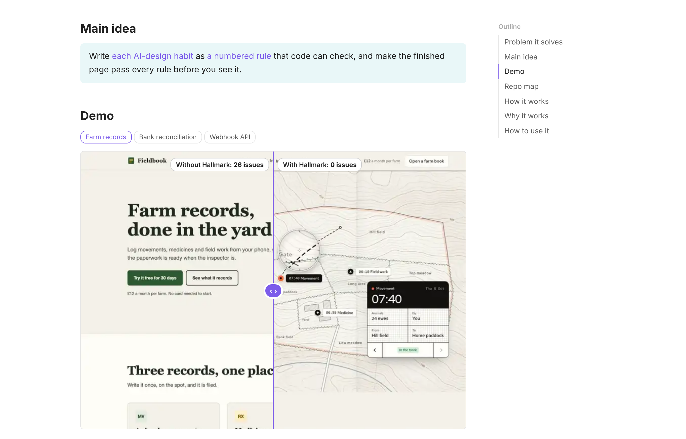
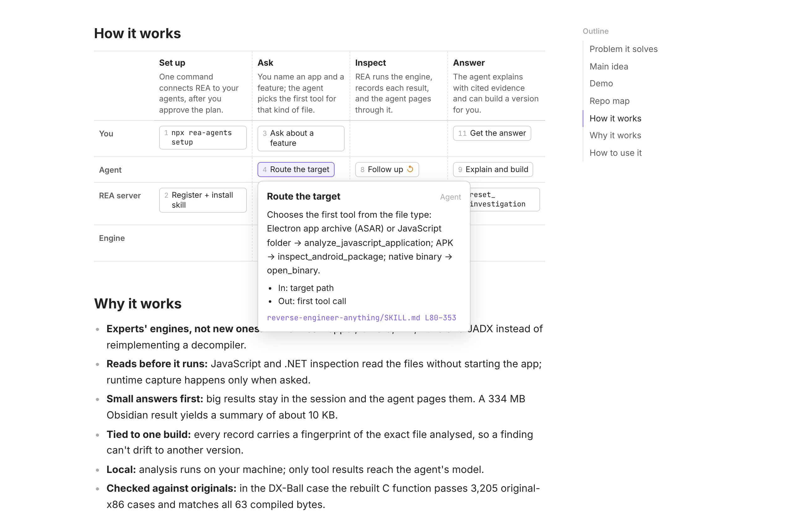
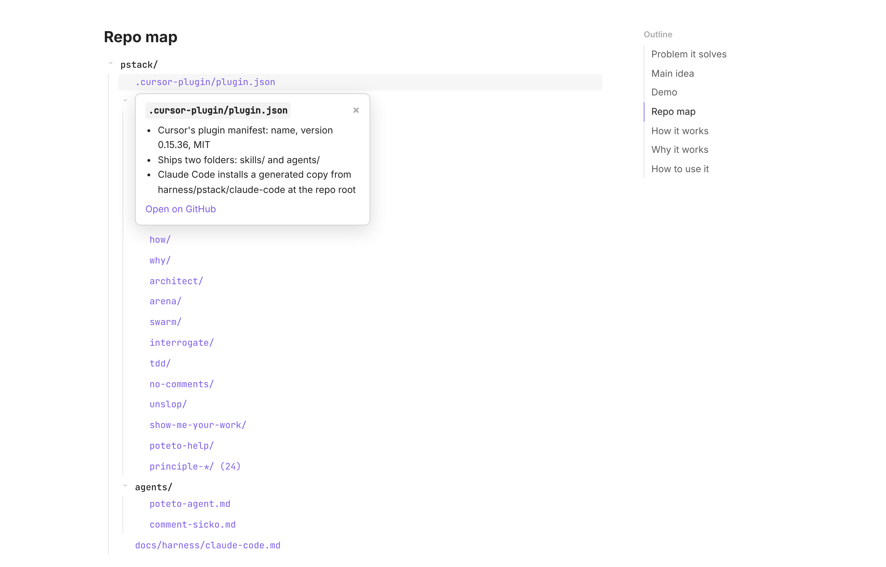

<div align="center">

# Repo Brief

**Understand any GitHub repo in a minute. No coding knowledge needed.**

English | [简体中文](README.zh-CN.md)

[See an example](https://gloriamu0001.github.io/repo-brief/hallmark.html) · [Get started](#get-started-in-3-steps) · [What to expect](#good-to-know)

</div>



## Who it's for

You found a tool on GitHub that looks useful. Then you opened its README and got lost in setup steps, code and jargon.

Repo Brief is a skill for your AI coding agent (Claude Code or Codex). You give it a GitHub link. The agent reads the whole repo for you and gives back **one simple web page** that answers:

- **Is it useful to me?** Which problem it solves, and for whom.
- **What does it actually do?** The main idea in one sentence, with real examples of its output.
- **How do I start?** A ready-made prompt that installs the tool for you.

You don't need to read code or understand the repo's README.

## See it first

Each page below was made by Repo Brief. Open one to see what you'll get.

| Repo | What it is | Brief |
| --- | --- | --- |
| [Hallmark](https://github.com/Nutlope/hallmark) | A design skill that stops AI-built web pages from looking AI-built | [Open](https://gloriamu0001.github.io/repo-brief/hallmark.html) |
| [REA](https://github.com/morluto/rea) | A tool that lets an AI agent look inside compiled apps | [Open](https://gloriamu0001.github.io/repo-brief/rea.html) |
| [pstack](https://github.com/cursor/plugins/tree/main/pstack) | Engineering playbooks for coding agents (one folder of a bigger repo) | [Open](https://gloriamu0001.github.io/repo-brief/pstack.html) |
| [Repo Brief](https://github.com/gloriamu0001/repo-brief) | This skill, explained by itself | [Open](https://gloriamu0001.github.io/repo-brief/repo-brief.html) |

| Click a step to see how it works (REA) | Click a file to see what's inside (pstack) |
| --- | --- |
|  |  |

## Get started in 3 steps

**1. Get an AI coding agent.** Install [Claude Code](https://claude.com/product/claude-code) or [Codex](https://developers.openai.com/codex), if you don't have one yet.

**2. Ask the agent to install Repo Brief.** Copy this prompt and paste it into Claude Code or Codex:

```text
Install the Repo Brief skill from https://github.com/gloriamu0001/repo-brief for all my projects.

1. Run: npx skills add gloriamu0001/repo-brief -g --agent <claude-code or codex, whichever you are>
   If npx doesn't work, copy the repo's skills/repo-brief folder into your global skills folder instead.
2. Check that git and Python 3 are installed. If one is missing, tell me how to install it.
3. Make sure Python can use Pillow. If it can't, run: python3 -m pip install Pillow
   If pip refuses (for example "externally-managed-environment"), install Pillow for this same python3 another way, for example brew install pillow on a Mac with Homebrew. Do not use sudo or --break-system-packages unless I say yes. Then check again that python3 can import Pillow.
4. Confirm that the skill's SKILL.md is in your global skills folder, and tell me its path.
```

**3. Ask for a brief.** Start a new session and type:

```text
Make a repo brief of https://github.com/owner/repo
```

The link can point to a whole repo or to one folder inside it. When the agent finishes, you get a file called `<name>-repo-brief.html` in your working folder. Double-click it to open it in your browser.

## What's on the page

Every brief has the same seven parts, in this order:

| Part | What it tells you |
| --- | --- |
| **Problem it solves** | Who has the problem, in one or two bullets |
| **Main idea** | How it works, in one sentence. Click the key words to see the real thing behind them |
| **Demo** | Real output from the repo: a before/after slider, a gallery, or an input and its result |
| **Repo map** | Only the files that matter. Click one to see what's inside |
| **How it works** | Who does what, step by step. Click a step for the details |
| **Why it works** | A few short reasons the approach works |
| **How to use it** | A copy-paste prompt that installs the tool, plus its main commands |

Everything is in that one file, so it's easy to keep and share. It reads well on a laptop and on a phone, in light and dark mode.

## Good to know

**How long it takes and what it costs.** We measured a full run of version 1.2.0 in Claude Code, on [vercel-labs/skills](https://github.com/vercel-labs/skills) (201 files), with Fable 5.1 as the main model. It took about 15 minutes. At API list prices it cost about $7.40:

| Step | Cost |
| --- | --- |
| Read the repo and write the page | about $5.40 |
| A helper the agent started to trace the code | about $2.00 |
| Reader test, on a small model | about $0.01 |
| Second reader test | not needed: it runs only when a fix rewrote a whole section |

- **Repo size changes the cost only a little.** In earlier runs, reading REA (7,448 files) took only about 20% more work than reading a small repo.
- **The cost changes from run to run.** The agent decides how much to read and whether to start a helper. Other main models cost differently. Earlier runs took 20–30 minutes.
- **Much larger repos are untested.** A repo with many more files than REA can take longer and cost more.
- **On a subscription plan,** a brief is a big task: expect it to use a noticeable part of your usage limit.

**Built to be safe with any repo.** The skill tells the agent to only read the repo's files. The agent must never run the repo's code, installers or scripts, and must ignore any instructions for AI agents written inside the repo.

**It checks its own work.** Before you see the page, a script checks that every file and line it points to really exists. Then a second AI reads only the page and answers seven questions about the repo (when your agent can start a second AI). Any answer it has to guess sends the agent back to fix that part.

<details>
<summary><b>Other ways to install</b> (Claude Code plugin, Cursor, OpenCode, by hand)</summary>

**As a Claude Code plugin.** Type these two commands in Claude Code:

```text
/plugin marketplace add gloriamu0001/repo-brief
/plugin install repo-brief@repo-brief
```

A plugin adds its name in front of the command, so you run it as `/repo-brief:repo-brief <link>`. You can also just ask in plain words, as in step 3.

**With the skills CLI**, in a terminal (needs [Node.js](https://nodejs.org)):

```sh
npx skills add gloriamu0001/repo-brief -g --agent claude-code
```

Replace `claude-code` with `codex`, `cursor` or `opencode` for another agent.

**By hand.** Copy the `skills/repo-brief/` folder into your agent's skills folder, for example `~/.claude/skills/repo-brief/`.

</details>

<details>
<summary><b>Requirements</b></summary>

- `git` and Python 3
- [Pillow](https://pypi.org/project/Pillow/) (`python3 -m pip install Pillow`), to put demo images into the page
- Optional: [Playwright](https://playwright.dev/python/) and its browsers (`python3 -m playwright install chromium firefox webkit`), for the layout check in the engines behind Chrome and Edge, Firefox and Safari. The check skips any engine that isn't installed.
- Optional: an agent that can start subagents, for the reader test. Without one, the agent skips the test and tells you.

</details>

<details>
<summary><b>How it works</b> (for the curious)</summary>

1. **Read.** The agent clones the repo and reads its code and settings. It treats the README as a claim and the files as the facts.
2. **Write.** It puts everything the page will show into one data file, `brief.json`, following the content rules in [`SKILL.md`](skills/repo-brief/SKILL.md).
3. **Check.** [`build.py`](skills/repo-brief/scripts/build.py) fills a fixed page template. It refuses to finish while anything is wrong: a missing section, a broken link, or a file or line that doesn't exist in the repo. It also opens the page at laptop and phone width in the engines behind Chrome and Edge, Firefox and Safari, to catch layout faults.
4. **Reader test.** A fresh agent on a small, cheaper model gets only the page's text and answers seven questions about the repo, marking any guesses. Every guess sends the agent back to fix that section. The test runs again only when a fix rewrote a whole section.
5. **Deliver.** You get one HTML file.

</details>

<details>
<summary><b>Repo layout</b> (for contributors)</summary>

```text
repo-brief/
├── README.md                          this page (English)
├── README.zh-CN.md                    this page (简体中文)
├── LICENSE
├── .claude-plugin/
│   └── marketplace.json               lets Claude Code install the skill as a plugin
├── docs/                              example briefs, served by GitHub Pages
│   ├── *.html                         the four example briefs
│   └── images/                        screenshots for this page
└── skills/
    └── repo-brief/                    the skill itself
        ├── SKILL.md                   workflow and content rules (start here)
        ├── agents/
        │   └── openai.yaml            display name and default prompt for Codex
        ├── assets/
        │   └── template.html          the page template
        ├── evals/
        │   └── evals.json             test cases for the skill (the four example repos)
        ├── references/
        │   ├── brief-format.md        every field of brief.json
        │   ├── checks.md              final checks and reader-test questions
        │   └── example-hallmark.json  a complete brief.json, used as the model
        └── scripts/
            └── build.py               checks, build, browser test, reader export
```

</details>

## Licence

MIT, see [LICENSE](LICENSE). Each example brief describes a third-party repo under its own licence (all MIT). The Hallmark demo images come from the Hallmark repo.
