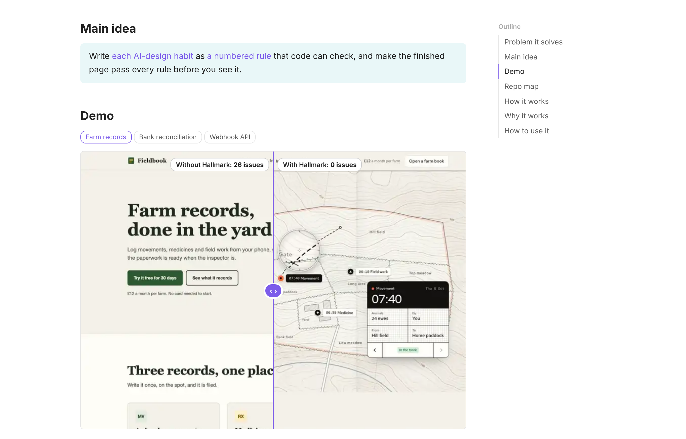
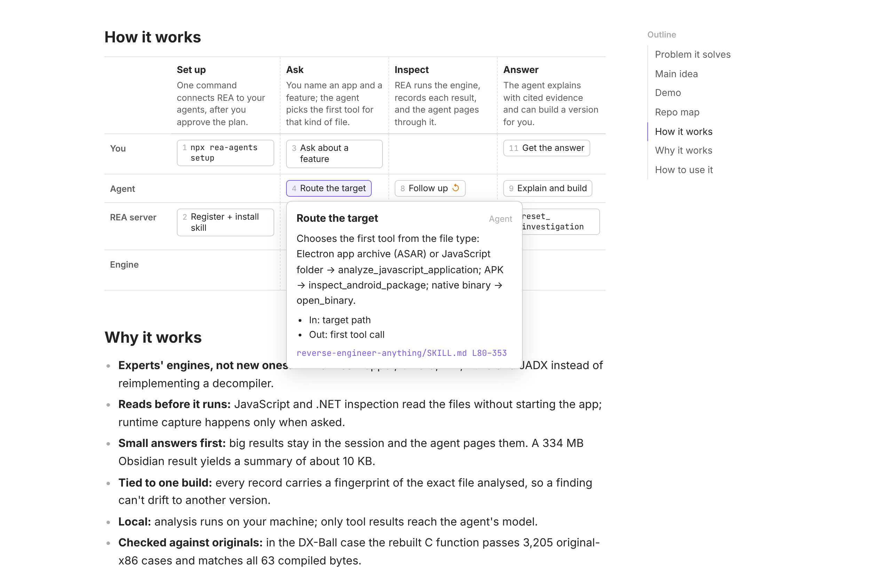
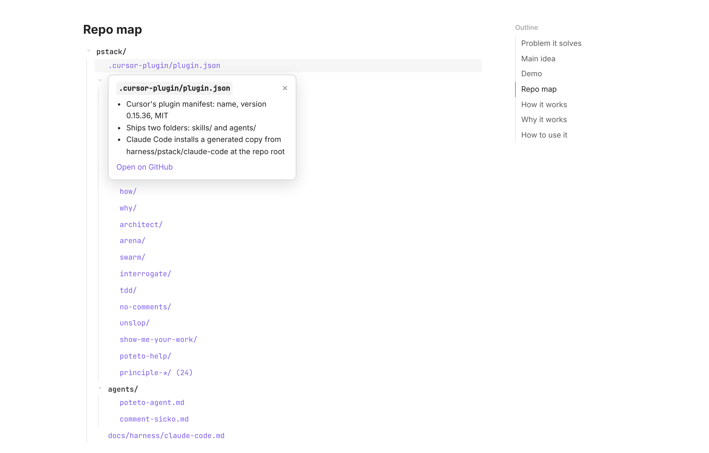

<div align="center">

# Repo Brief

**一分钟看懂任何 GitHub 仓库，不需要懂代码。**

[English](README.md) | 简体中文

[看一个示例](https://gloriamu0001.github.io/repo-brief/hallmark.html) · [三步上手](#三步上手) · [使用须知](#使用须知)

</div>



## 适合谁用

你在 GitHub 上发现了一个看起来很有用的工具，打开它的 README，却被安装步骤、代码和术语绕晕了。

Repo Brief 是给 AI 编程助手（Claude Code 或 Codex）用的一个技能（skill）。你给它一个 GitHub 链接，助手会替你读完整个仓库，然后交给你**一个简单的网页**，回答三个问题：

- **它对我有用吗？** 它解决什么问题，为谁解决。
- **它到底做什么？** 用一句话讲清核心思路，并附上它真实产出的例子。
- **我怎么开始用？** 一段现成的提示词，让助手帮你装好这个工具。

你不需要读代码，也不需要看懂原仓库的 README。

## 先看效果

下面每个页面都是 Repo Brief 生成的。打开一个，看看你会得到什么。

| 仓库 | 它是什么 | 简报 |
| --- | --- | --- |
| [Hallmark](https://github.com/Nutlope/hallmark) | 一个设计技能，让 AI 做出的网页不再一看就是 AI 做的 | [打开](https://gloriamu0001.github.io/repo-brief/hallmark.html) |
| [REA](https://github.com/morluto/rea) | 让 AI 助手查看已编译应用内部结构的工具 | [打开](https://gloriamu0001.github.io/repo-brief/rea.html) |
| [pstack](https://github.com/cursor/plugins/tree/main/pstack) | 给编程助手用的工程实践手册（一个大仓库里的一个文件夹） | [打开](https://gloriamu0001.github.io/repo-brief/pstack.html) |
| [skills](https://github.com/vercel-labs/skills) | 一条命令，把 agent 技能一次装进所有编程助手 | [打开](https://gloriamu0001.github.io/repo-brief/skills.html) |

示例页面是英文的。

| 点开一个步骤，看它怎么运作（REA） | 点开一个文件，看里面有什么（pstack） |
| --- | --- |
|  |  |

## 三步上手

**1. 准备一个 AI 编程助手。** 如果还没有，先安装 [Claude Code](https://claude.com/product/claude-code) 或 [Codex](https://developers.openai.com/codex)。

**2. 让助手安装 Repo Brief。** 复制下面的提示词，粘贴到 Claude Code 或 Codex 里：

```text
Install the Repo Brief skill from https://github.com/gloriamu0001/repo-brief for all my projects.

1. Run: npx skills add gloriamu0001/repo-brief -g --agent <claude-code or codex, whichever you are>
   If npx doesn't work, copy the repo's skills/repo-brief folder into your global skills folder instead.
2. Check that git and Python 3 are installed. If one is missing, tell me how to install it.
3. Confirm that the skill's SKILL.md is in your global skills folder, and tell me its path.
```

**3. 让它生成简报。** 新开一个会话，输入：

```text
Make a repo brief of https://github.com/owner/repo
```

链接可以指向整个仓库，也可以指向仓库里的某个文件夹。完成后，你的工作文件夹里会出现一个名为 `<name>-repo-brief.html` 的文件，双击就能在浏览器里打开。

简报目前只用英文撰写。

## 页面上有什么

每份简报都有相同的七个部分，顺序固定：

| 部分 | 告诉你什么 |
| --- | --- |
| **Problem it solves（解决什么问题）** | 谁遇到了这个问题，一到两条要点 |
| **Main idea（核心思路）** | 用一句话说清它怎么运作。点击关键词可以看到背后的真实内容 |
| **Demo（演示）** | 仓库的真实产出：前后对比滑块、一个完成的成品，或一个输入及其结果 |
| **Repo map（仓库地图）** | 只列出重要的文件。点开一个就能看到里面有什么 |
| **How it works（运作方式）** | 谁在哪一步做什么。点开一步查看细节 |
| **Why it works（为什么有效）** | 几条简短的理由，说明这个方法为什么行得通 |
| **How to use it（怎么用）** | 一段可直接复制的安装提示词，以及主要命令 |

所有内容都在这一个文件里，方便保存和分享。在电脑和手机上、浅色和深色模式下都能正常阅读。

## 使用须知

**需要多长时间。** 我们在 Claude Code 中用 Opus 5.5 模型测试了 [vercel-labs/skills](https://github.com/vercel-labs/skills)（201 个文件），一份简报用时约 7 分钟。和其他较长的 AI 任务一样，它会占用你套餐的一部分用量额度。比 REA（约 7,400 个文件）大得多的仓库还没有测试过。

**设计上可以放心用于任何仓库。** 本技能要求助手只读取仓库里的文件：绝不运行仓库里的代码、安装程序或脚本，并忽略仓库里写给 AI 助手的任何指令。

**它会自己检查。** 在你看到页面之前，一个脚本会确认页面提到的每个文件和每一行代码都真实存在。然后另一个 AI 只读这个页面，回答关于仓库的七个问题（前提是你的助手能启动第二个 AI）。凡是会误导读者的地方，助手都会回去修改。

<details>
<summary><b>其他安装方式</b>（Claude Code 插件、Cursor、OpenCode、手动安装）</summary>

**作为 Claude Code 插件安装。** 在 Claude Code 里输入这两条命令：

```text
/plugin marketplace add gloriamu0001/repo-brief
/plugin install repo-brief@repo-brief
```

插件会在命令前加上自己的名字，所以运行时要输入 `/repo-brief:repo-brief <链接>`。你也可以像第 3 步那样直接用自然语言提出要求。

**使用 skills 命令行工具**，在终端里运行（需要先安装 [Node.js](https://nodejs.org)）：

```sh
npx skills add gloriamu0001/repo-brief -g --agent claude-code
```

如果用的是其他助手，把 `claude-code` 换成 `codex`、`cursor` 或 `opencode`。

**手动安装。** 把 `skills/repo-brief/` 文件夹复制到你的助手的技能文件夹里，例如 `~/.claude/skills/repo-brief/`。

</details>

<details>
<summary><b>运行环境要求</b></summary>

- `git` 和 Python 3
- 仅当仓库的演示是图片时需要：[Pillow](https://pypi.org/project/Pillow/)（`python3 -m pip install Pillow`）。需要时助手会自动安装。
- 可选：[Playwright](https://playwright.dev/python/) 和 Chromium（`python3 -m playwright install chromium`），用于检查版面。没有安装时，构建结果会注明 "layout not checked"（未检查版面）。
- 可选：能启动子代理（subagent）的 AI 助手，用于阅读帮手和读者测试。没有的话，助手会自己阅读仓库，跳过这项测试并告诉你。

</details>

<details>
<summary><b>运作原理</b>（给好奇的你）</summary>

1. **阅读。** 助手克隆仓库。一个使用更便宜模型的帮手读取代码和配置，交回一份事实清单，由助手抽查核实。README 只算“说法”，文件才是“事实”。
2. **撰写。** 它把页面要展示的所有内容写进一个数据文件 `brief.json`，并遵守 [`SKILL.md`](skills/repo-brief/SKILL.md) 里的内容规则。
3. **检查。** [`build.py`](skills/repo-brief/scripts/build.py) 把内容填进固定的页面模板。只要有任何问题，它就拒绝完成：缺少某个部分、链接失效，或者提到的文件或行号在仓库里不存在。如果装了 Playwright，它还会用 Chromium（Chrome 和 Edge 背后的浏览器引擎）分别以电脑和手机宽度打开页面，检查版面问题。
4. **读者测试。** 一个使用小模型的全新助手只拿到页面文字，回答关于仓库的七个问题，并列出会让读者困惑的地方。助手据此修改对应的部分。
5. **交付。** 你得到一个 HTML 文件。

</details>

<details>
<summary><b>仓库结构</b>（给贡献者）</summary>

```text
repo-brief/
├── README.md                          本页（英文）
├── README.zh-CN.md                    本页（简体中文）
├── LICENSE
├── .claude-plugin/
│   └── marketplace.json               让 Claude Code 能以插件方式安装本技能
├── docs/                              示例简报，通过 GitHub Pages 发布
│   ├── *.html                         示例简报
│   └── images/                        本页用到的截图
└── skills/
    └── repo-brief/                    技能本体
        ├── SKILL.md                   工作流程和内容规则（从这里开始读）
        ├── agents/
        │   └── openai.yaml            Codex 用的显示名称和默认提示词
        ├── assets/
        │   └── template.html          页面模板
        ├── evals/
        │   └── evals.json             技能的测试用例（三个示例仓库）
        ├── references/
        │   ├── brief-format.md        brief.json 的所有字段
        │   ├── checks.md              最终检查项和读者测试问题
        │   └── example-hallmark.json  一份真实的 brief.json（规则列表已缩短），作为范例
        └── scripts/
            └── build.py               检查、生成、浏览器测试、导出读者测试文本
```

</details>

## 许可证

MIT，详见 [LICENSE](LICENSE)。每份示例简报介绍的都是第三方仓库，各自遵循其许可证（均为 MIT）。Hallmark 的演示图片来自 Hallmark 仓库。
